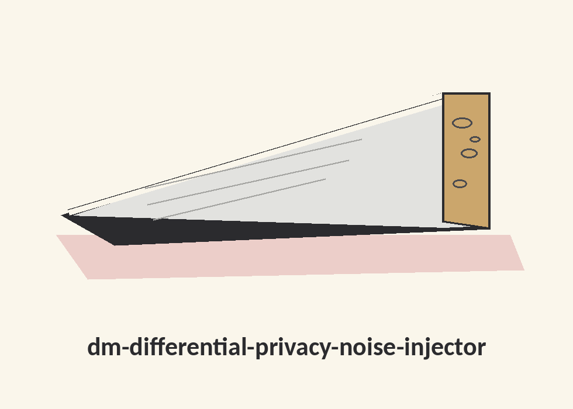
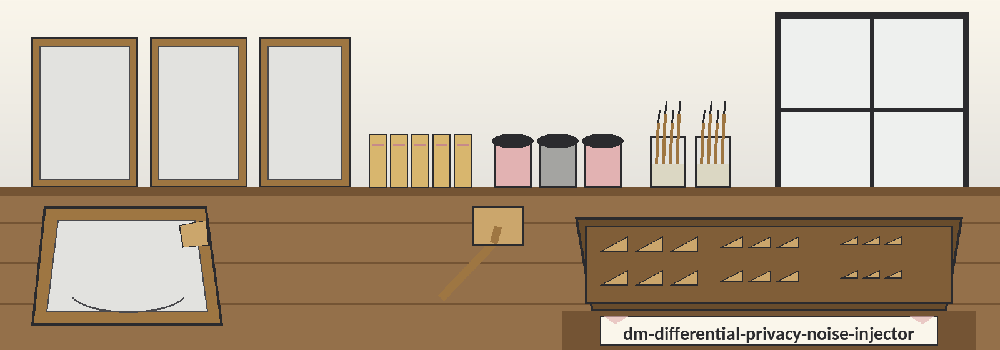

# dm-differential-privacy-noise-injector

Inventory entry, medium noted first: the name above is set in Carlito in charcoal, with a small jar image at the left of this title block and a miniature stretcher key sketched beside this opening heading only. Later headings keep the inventory costume without the miniature.

# dm-differential-privacy-noise-injector
Adds Laplacian noise to numerical data. This is a per value Laplace mechanism with an operator supplied sensitivity and epsilon. Sensitivity is asserted by the operator and is never checked against the data, and no epsilon budget is tracked across runs, so running the same data more than once adds up in a way this tool does not record or limit. - Focused on Tools designed to generate or mask sensitive data with realistic-looking but meaningless values

> Inventory slip: Sensitivity counts as asserted, never verified against actual figures.

> Inventory slip: Nobody tallies any epsilon budget across successive jobs.

## Choosing parameters

Epsilon is the privacy parameter for a single run. A smaller epsilon adds more noise and gives stronger privacy for that run. A larger epsilon adds less noise and gives weaker privacy, so the output stays closer to the original values.
Sensitivity is the largest change one person or one record could make to a value in the named column, in the units of that column. Set it from what you know about the data before you run the tool. If a column can span hundreds, a sensitivity of 1 is too small for that column. The default sensitivity is 1.0.
The output file must not be the same file as the input file. A run that noises no values exits with an error and writes no output file.

> Inventory slip: Destination must differ from source.

> Inventory slip: A job noising zero values exits carrying an error, writing zero output file.

## Install
`git clone https://github.com/ShadowStrikeHQ/dm-differential-privacy-noise-injector`

> Inventory slip: the README clone line names an earlier organisational banner. It is preserved exactly as printed. The repair lives on the website, labelled as a repair.

## Usage
`./dm-differential-privacy-noise-injector [params]`

## Parameters
- `-h`: Show help message and exit
- `--sensitivity`: No description provided
- `--column`: No description provided
- `--delimiter`: No description provided

> Inventory slip, the gap at full size: the Choosing parameters prose above discusses epsilon and the named column at length, yet this parameter list contains no epsilon flag at all, and it gives --sensitivity, --column, and --delimiter each as "No description provided", with the delimiter given no prose anywhere. Both halves stand exactly as printed. Nothing here resolves the seam.

## License
Copyright (c) ShadowStrikeHQ

## Shut in the key drawer

The primary control of this re-skin reads Tap the Wedge. Its epsilon field label reads Epsilon, Single Run. Its sensitivity field label reads Sensitivity, Default 1.0. Its guard title reads Output Never Equals Input. Its empty job title reads No Values Noised, No File Written. It ends with the wedge seated inside the finished piece on the easel: canvas taut, workshop hushed, drawer shut.
